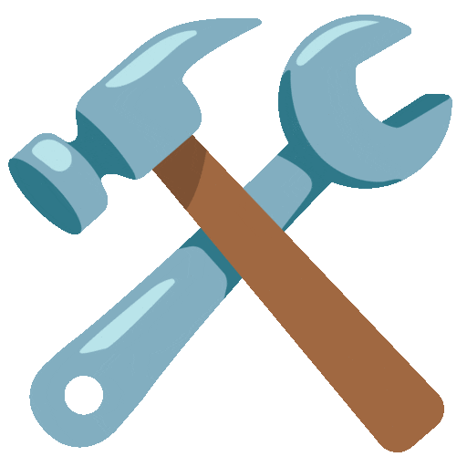
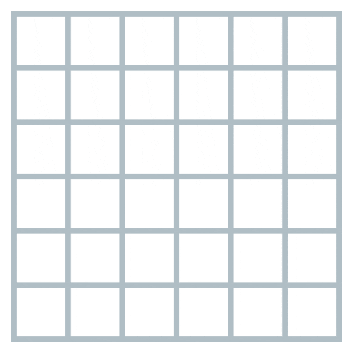

<h1>
  Hi
  
  , I'm Swarup
</h1>

 
<!-- 
   -->

&nbsp;

&nbsp;

<h2>
  
  About Me
</h2>

Hey! I'm **Swarup**, a Computer Science graduate who spends a lot of time building things with code.

- Currently working with **Java, Spring Boot, and React**
- Enjoy building backend systems, REST APIs, and web applications
- Usually experimenting with something new or figuring out how things work
- Outside coding, I'm into gaming and game development
- Always up for interesting projects and collaborations

<h2> Languages & Tools</h2>

### Languages

  &nbsp;&nbsp;
  &nbsp;&nbsp;
  &nbsp;&nbsp;
  &nbsp;&nbsp;
  &nbsp;&nbsp;
  &nbsp;&nbsp;
  &nbsp;&nbsp;
  &nbsp;&nbsp;
  

### Frameworks & Libraries

  &nbsp;&nbsp;
  &nbsp;&nbsp;
  &nbsp;&nbsp;
  &nbsp;&nbsp;
  

### Tools & Platforms

  &nbsp;&nbsp;
  &nbsp;&nbsp;
  &nbsp;&nbsp;
  &nbsp;&nbsp;
  &nbsp;&nbsp;
  &nbsp;&nbsp;
  

<h2> GitHub Stats</h2>

  
  &nbsp;&nbsp;
  

<h2> GitHub Stats</h2>

  

 

*Thanks for stopping by! Feel free to check out my repositories.* 👨‍💻

